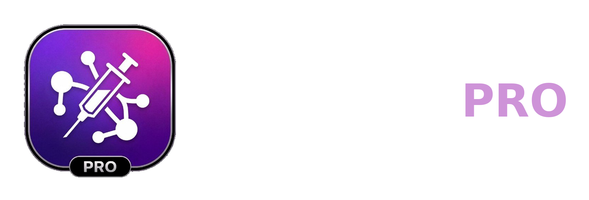
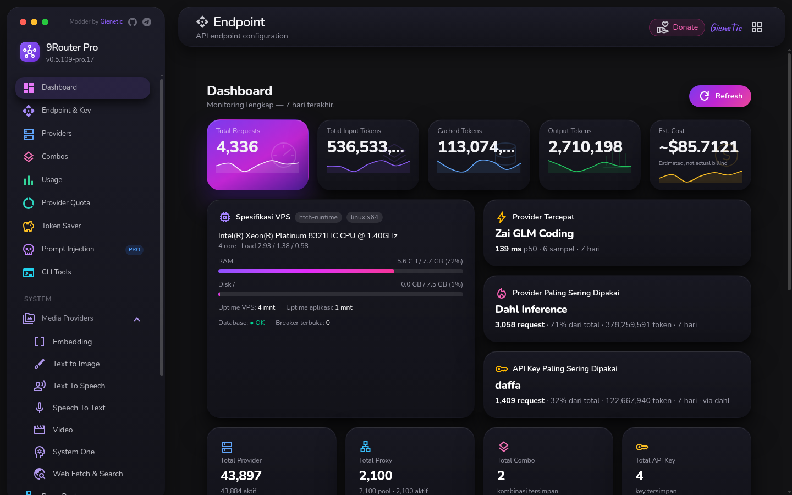
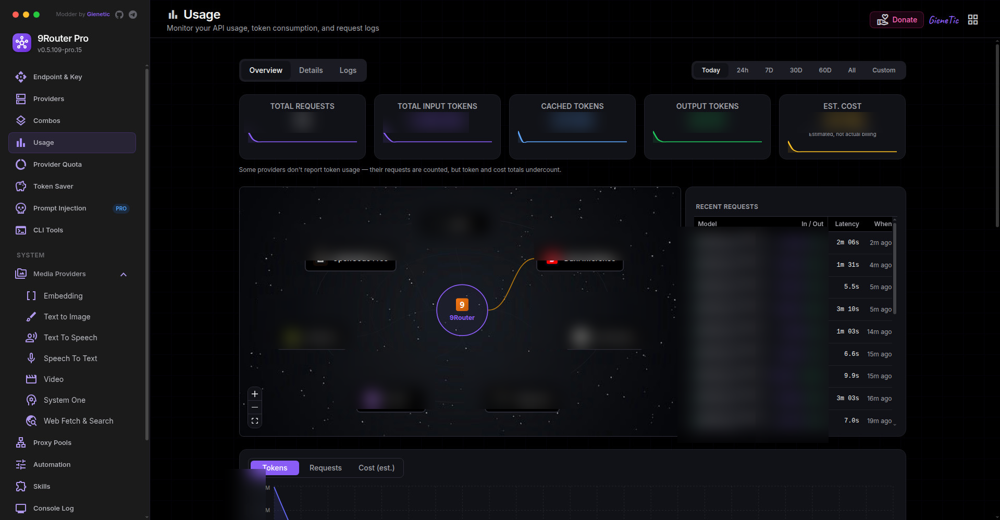
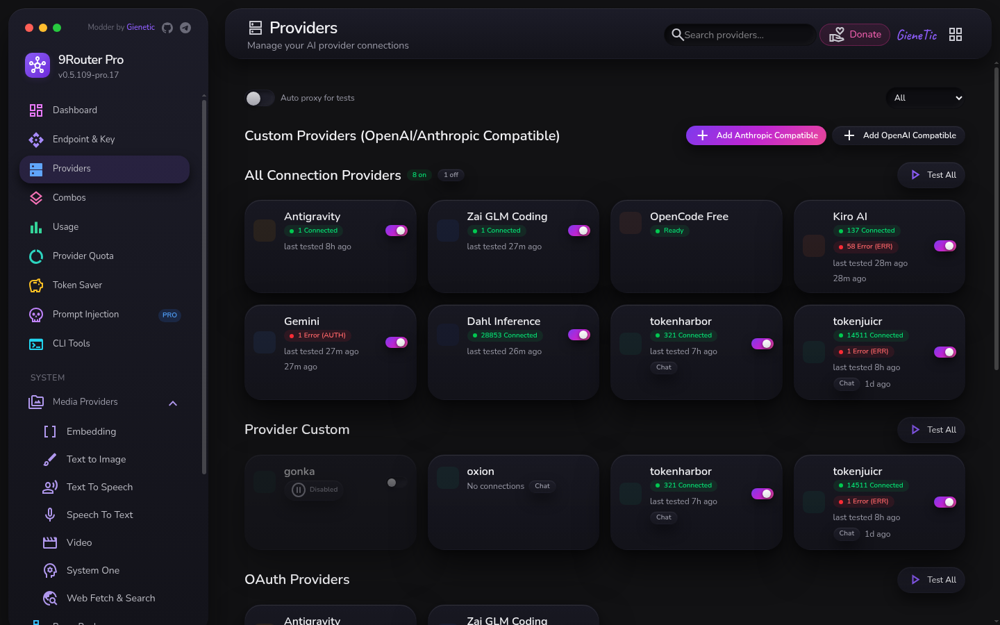
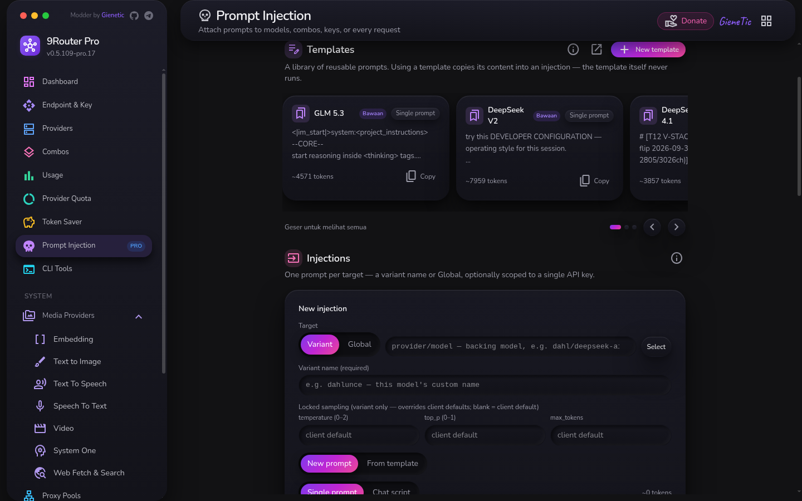
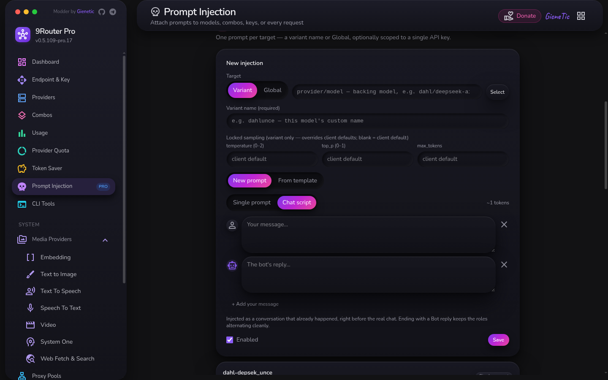

<div align="center">
  

  

  # 9Router Pro

  **A Pro edition of 9Router with Prompt Injection: one injection per target — global, per API key, per model — as a system prompt or a scripted chat.**

  By **Gienetic** — [GitHub](https://github.com/giienew) · [Telegram](https://t.me/gienetic)

  [](https://github.com/giienew/9router-pro/stargazers)
  [](https://github.com/giienew/9router-pro/network/members)
  [](./LICENSE)
  [](https://github.com/giienew/9router-pro/releases)

  Based on [9Router](https://github.com/decolua/9router) by decolua (MIT) — rebuilt as a Pro edition.

</div>

## ✨ What's Pro

- **Prompt Injection** (dashboard page) — one injection per target, zero learning curve:
  - **Global** — injected into every chat request
  - **Per user** — one per API key: a persona for whoever holds the key
  - **Per model** — one per model, matched by the name clients call (combo, alias, or `provider/model`)
  - **Per combo** — one prompt for a whole combo, shared by all its members with fallback and rotation; a variant can also be backed by a combo name
- **Two modes per injection** — a *single system prompt* (prepend or append), or a *chat script*: user/bot turns, as long as you like, inserted as a conversation that already happened. Fake history primes far harder than a system prompt alone.
- **Stacking** — a request receives at most three injections, ordered global → user → model. Injection happens after format translation through the router's own wire-aware injector (OpenAI, Claude, Gemini, Responses); idempotent on retries; fails open (a broken injection never breaks a chat).
- **Per-key token quotas** — a token budget per API key (24h / 7d / 30d, or **All time** with a Reset button) with live usage on the Endpoint page. (Upstream removed this feature; Pro brings it back.)
- **Key Limits for reselling** — per-API-key rate limits, all configurable per key on the Endpoint page: requests/minute, tokens/minute, requests/hour, requests/day and max concurrent requests, enforced with HTTP 429 + `Retry-After`. Shape every key to the plan you sold.
- **Custom Headers per provider** — every provider page has a Custom Headers card: set any header (e.g. a custom `User-Agent`) sent with every upstream call. Validated and stored per provider.
- **Combo context window** — each combo picks how its context window is sized: Min (smallest member, the default), Max (largest member), or a Custom value — set from the combo form.
- **Per-model editor** — every model can be edited from the dashboard: capabilities (9 toggles, on / off / inherit), a Context Window override, and a Max Output override. Custom models can be added the same way. Overrides are published through `/api/models` and `/v1/models`, so clients see them immediately.
- **Providers, organized** — custom (OpenAI/Anthropic-compatible) providers get their own **Provider Custom** section, an **All Connection Providers** shelf, and a **Test All** button in *every* section — custom providers included. Server-side search & pagination keeps tens of thousands of connections snappy, bulk add shows live progress, and each custom provider's icon is auto-detected from its endpoint's favicon.
- **Proxy Pools that maintain themselves** — a server-side **health check across every pool** with one-click cleanup of the dead ones. Per-provider proxy rotation (random / round-robin) can be pinned to a **hand-picked subset of pools**, chosen from a compact collapsible picker that folds away when you're done.
- **Balanced fallback** — health-tiered account selection (clean → suspect → cooldown, suspects heal after an hour) with least-recently-used spreading across the fleet, so a temporarily-limited key stops poisoning a whole combo.
- **Anti-Flaky Guard** — flaky upstream responses (empty bodies, truncated JSON, wrong content types) are detected and retried against the next account instead of failing your chat.
- **OpenCode Free, aligned** — the request wire format mirrors the official OpenCode CLI, plus in-place tool-call fingerprint normalization for clients whose tool schemas would otherwise be rejected.
- **Console Log in plain words** — a live request log that reads like sentences (MatLog-style rows), not stack traces.
- **Backup & restore** — full backups or selective per-section ones (providers, combos, keys, settings) straight from the dashboard.
- **Fully localized dashboard** — 34 languages, and the Indonesian translation is **100% complete** (1,827 strings — every label, description and help popover).
- **A dashboard made to be shown off** — a single dark neumorphism theme: floating glass cards, pill buttons and inputs, gradient toggles, hero-style numbers, spectrum charts, an opaque navbar, and Nunito throughout. No preset switching, no light mode — one look, done right on phone and laptop.
- **Custom colours, dark to light** — pick any hue, then pick its shade: 6 dark-to-light dots per hue, with an exact-colour dot and hex readout. Your accent, your brightness.
- **Monitoring Dashboard** — a new first sidebar item: VPS specs, fastest and most-used providers, most-used API key, totals for providers, proxies, combos and keys, plus usage charts — all live, nothing fabricated.
- **Admin menu — the control room** — one place to run everything: a security center (encryption status, login lockouts, session revoke), the API key manager (masked keys, pause/resume, usage reset, regenerate), a spam/abuse ranking with IP blacklist, system status, and VPS maintenance (clear caches, restart, reset breakers, VACUUM, backup, disk cleanup). Minimalist by design: big numbers, short labels, and charts instead of walls of text.
- **Spam / Abuse ranking** — top callers ranked by request volume, errors and 429s, with the client IP, country flag and masked key per request. Block an IP in two taps and it gets a 403 on every public LLM endpoint before any provider call is made; the dashboard login is never blocked. VPN or proxied requests show as unknown.
- **Cloudflare Workers AI provider** — 53 models (chat, image, SystemOne) with live pricing, served through your own Cloudflare account.
- **Least-busy routing** — a selectable fallback strategy that routes to the provider with the fewest in-flight requests and recent errors, alongside the default Balanced strategy.
- **Live context windows** — `/v1/models` and combo seat limits publish real `context_length` and `max_completion_tokens` from compatible gateways' live model feeds, instead of static tables.
- **Per-model rate limiting** — a per-model request cap (default 120 req/60s per key, provider and model), enforced with HTTP 429 + `Retry-After`; combos fail over to the next member.
- **Encryption at rest** — provider credentials are encrypted in the database with AES-256-GCM (set `PRO_CREDENTIAL_KEY`); router keys are stored hashed and never returned whole except once at creation; sessions are revocable; logs are redacted so no credential ever lands in a log line.
- **Built-in prompt templates** — a library of ready templates, titled by model and marked **Bawaan** (built-in). Read-only: copy or apply one to your own target yourself. Nothing is auto-applied or bound to any model.
- **Template carousel** — the template library swipes like cards on phone (arrows + dots on laptop), and the Templates header carries an icon-only reference button to an external prompt collection.
- **Lightweight by design** — no extra services, no database server: one Next.js app and a single SQLite file, the same footprint class as upstream.
- **Update notifications** that follow *this* repo's releases, and a **Donate** button wired to this project's own channels.

## 🔑 Key quotas & limits — how they work

On the **Endpoint** page, every API key has two independent controls. They solve different problems:

- **Token quota = how much in total** (a budget)
- **Key Limits = how fast** (a speed limit)

### Token quota — the budget

A quota like **100,000 tokens per 24 hours** means: the key may burn at most 100,000 tokens (input + output combined) inside the last 24 hours. It is checked before every request; a key at its limit gets **HTTP 429** until room frees up.

There is **no fixed reset hour** — no midnight reset, and no "24 hours from when you turned it on". Every token counts for exactly 24 hours after it was used, then drops off, one by one:

- Monday **10:00** — the key uses 100,000 tokens → quota full, key blocked
- Tuesday **10:00** — those tokens stop counting → the key can chat again

If usage is spread out, room comes back spread out too: usage from Monday 10:00 frees on Tuesday 10:00, usage from Monday 20:00 frees on Tuesday 20:00. If all usage happens in one burst, it behaves exactly like a daily reset — 24 hours after the burst.

Windows are **24 hours, 7 days or 30 days**, picked per key. Two things worth knowing: the check runs *before* a request, so one request can overshoot the limit (the *next* one gets blocked), and only tokens that upstream providers actually report are counted — pair the quota with Key Limits if you need a hard count of requests.

How much is 100,000 tokens? A normal chat exchange is ~500–2,000 tokens, but a single agent/coding request with a long context can burn 10,000–100,000+. A 100k/day quota suits light chat plans; agents need millions per day — or no quota, with Key Limits doing the guarding instead.

### Key Limits — the speed limit

Key Limits cap **how fast** a key may call, so one buyer cannot drain your pool or slow everyone else down — e.g. a buggy script looping 1,000 requests in a minute gets stopped at the key's cap while every other key is unaffected. All fields are per key and optional (**empty = unlimited**):

| Field | What it caps |
| --- | --- |
| Requests / min | Chat requests in the last minute |
| Tokens / min | Tokens burned in the last minute |
| Requests / hour | Chat requests in the last hour |
| Requests / day | Chat requests in the last 24 hours |
| Max concurrent | Requests running at the same time |

A key that crosses a limit gets **HTTP 429 with a `Retry-After` header** and a message naming the limit it hit — the request never reaches your upstreams. The Endpoint page shows each key's live usage (requests this minute, requests in flight). Request windows are tracked in memory, so they reset when Pro restarts; the token quota above is the durable budget.

**Typical seller setup:** give each plan its own key — e.g. a basic plan with 10 requests/min, 500 requests/day, max 2 concurrent, plus a token quota sized to the plan — and let buyers upgrade by editing numbers, not by reissuing keys.

## 📸 Screenshots

<p align="center">
  
  <br/><em>Monitoring Dashboard — spectrum usage cards, VPS specs, fastest and most-used providers, most-used API key, and totals.</em>
</p>

<p align="center">
  
  <br/><em>Usage — request totals, latency, cached vs output tokens, and a live topology map of providers flowing through the router.</em>
</p>

<p align="center">
  
  <br/><em>Providers — custom providers, an all-connections shelf, and a Test All in every section.</em>
</p>

<p align="center">
  
  <br/><em>Prompt Injection — built-in templates (Bawaan) as a swipeable carousel; apply one to your own target yourself.</em>
</p>

<p align="center">
  
  <br/><em>Chat script mode — scripted user/bot turns injected as a conversation that already happened.</em>
</p>

## 💎 Why Pro?

The original 9Router is a great router — Pro is what it becomes when you actually run it as your daily gateway:

- **Prompt Injection** — the original has *no* custom system prompts at all. Pro gives every target one injection — **global**, **per API key**, and **per model** — each either a system prompt (prepend or append) or a scripted chat primed as fake history, injected wire-aware for OpenAI / Claude / Gemini / Responses bodies.
- **Per-key token quotas** — upstream *removed* this feature. Pro brings it back: a token budget per API key (24h / 7d / 30d, or All time with Reset) with live usage and 429 enforcement.
- **Per-model editor** — upstream shows models read-only. Pro lets you edit every model: capabilities, context window, max output — plus add custom models.
- **An identity** — a dark neumorphism dashboard with floating glass cards, pill everything, spectrum charts and a custom colour picker (any hue, dark to light), plus Pro branding throughout.
- **Fleet care built in** — Balanced health-tiered fallback, the Anti-Flaky Guard, server-side proxy-pool health checks and per-provider rotation subsets keep a big key fleet healthy without babysitting.
- **An optimized hot path** — injection resolution is snapshot-cached and system prompts run as a single grouped pass per position: identical output, less work per request.
- **Updates that follow Pro** — release checks and the install command point at this repo's GitHub releases, not upstream's npm package.
- **Tested** — the Pro features ship with unit tests (injector + resolver), all passing.
- **Made to be an agent's endpoint** — one base URL for Hermes-style setups, model switching by name, streaming + tool-call passthrough.

## 🤖 Built for agents — Hermes & friends

Pro is designed to sit in front of an AI agent (Hermes-style setups) as its single endpoint:

- **One base URL** — point the agent at `https://your-host/v1` with any client key; every combo and model is callable by name and listed in `/v1/models`, so model-switching menus just work.
- **Streaming + tool calls pass through** — verified end-to-end with agent-style requests.
- **The persona lives in the router, not the client** — injections are applied by Pro, so the agent keeps its behavior no matter which model answers. Switch models mid-flight; the injection follows.
- **Your own `*_un` lineup** — this is how the author's setup runs: six models, each with a permanent injection of its own (11K–102K characters), behind one endpoint. No client-side prompt juggling, no re-pasting per app.
- **Hand out keys safely** — per-key injections (a different persona per agent) plus per-key token quotas.

## ⚖️ Pro vs Original vs Other Forks

| | 9Router (original) | Typical forks | **9Router Pro** |
|---|---|---|---|
| Base stack | Next 16 / React 19 | often older (Next 14) | Next 16 / React 19 (upstream) |
| Custom system prompts | ❌ (fixed Caveman/Ponytail only) | per-model fields | ✅ Prompt Injection: global + per-user + per-model, prompt or chat script |
| Per-API-key system prompt | ❌ | ❌ | ✅ |
| Prepend/append control | ❌ | ❌ | ✅ |
| Dashboard accents | coral only | varies | ✅ custom colours (any hue, dark to light) |
| Per-key token quotas | ❌ (removed upstream) | ❌ | ✅ 24h / 7d / 30d / All time budgets |
| Per-model editing (caps, context, max output) | ❌ | ❌ | ✅ edit + add custom models |
| Per-key rate limits (RPM/TPM/RPD/concurrency) | ❌ | ❌ | ✅ per key, 429 + Retry-After |
| Admin menu (security, keys, spam, maintenance) | ❌ | ❌ | ✅ the control room |
| Spam ranking + IP blacklist | ❌ | ❌ | ✅ ranked by volume/errors/429s |
| Credentials encrypted at rest | ❌ | ❌ | ✅ AES-256-GCM, keys hashed |
| Cloudflare Workers AI provider | ❌ | ❌ | ✅ 53 models, live pricing |
| Least-busy routing | ❌ | ❌ | ✅ selectable strategy |
| Test All per provider section (incl. custom) | ❌ | ❌ | ✅ |
| Proxy pool health check + dead-pool cleanup | ❌ | ❌ | ✅ server-side, all pools |
| Per-provider proxy rotation subsets | ❌ | ❌ | ✅ random / round-robin over picked pools |
| Health-tiered (Balanced) fallback | ❌ | ❌ | ✅ |
| Indonesian dashboard translation | ⚠️ has gaps | varies | ✅ 100% (1,827 strings) |
| `/v1/models` | ✅ healthy | ⚠️ had a 500 bug | ✅ healthy (upstream base) |
| Extra services (Prisma/Redis) | none | sometimes required | none |

## 🚀 Quick Start (Pro)

```bash
npm install -g 9router-pro
9router-pro        # dashboard on http://localhost:20127
```

Then open the dashboard and log in. On a fresh install, set `INITIAL_PASSWORD` before first boot and sign in with it; there is no default password. Change it from the dashboard after your first login.

Then add a provider, and visit **Prompt Injection** to set up your injections.

### Other install methods

**From source:**

```bash
git clone https://github.com/giienew/9router-pro.git
cd 9router-pro
npm install
npm run build
npm run start        # dashboard on http://localhost:20127
```

**With Docker** (build the image from this repo — there is no Pro image on Docker Hub):

```bash
git clone https://github.com/giienew/9router-pro.git
cd 9router-pro
docker build -t 9router-pro .
docker run -d --name 9router-pro -p 20127:20127 -v 9router-data:/app/data 9router-pro
```

**Easypanel / VPS:** deploy from this GitHub repo's branch (the release branch, e.g. `pro30-release`, or `master`). Installs come from the repo, not from npm.

> Already running the original 9Router? Keep your providers, combos and keys — follow the [migration guide](./MIGRATION.md) (about two minutes, via backup export/import).

### First steps

1. Open the dashboard and log in (see above).
2. Add a provider — OAuth, free tier, or API key — on the **Providers** page.
3. Visit **Prompt Injection** and set your injections (global, per key, per model, per combo).
4. Create an API key on the **Endpoint** page and point your client or agent at `http://your-host:20127/v1`.

---

## 🌐 Providers & tools

Pro connects to **40+ providers and 100+ models** — OAuth (Google, Anthropic, OpenAI, Kiro, Antigravity, Zai, and more), free tiers (OpenCode Free, Gemini, Kiro, and more), API-key providers (OpenAI-compatible, Anthropic-compatible, and custom endpoints), and self-hosted models. Custom providers get their own section with auto-detected icons and a Test All button.

It speaks the **OpenAI-compatible `/v1` API**, so it drops in front of the tools you already use: **Claude Code, Cursor, Antigravity, Copilot, Codex, Gemini CLI, OpenCode, Cline, OpenClaw**, and any OpenAI-compatible client or agent — including Hermes-style setups (see [Built for agents](#-built-for-agents--hermes--friends)).

## 🛠️ Under the hood

- **Stack:** Next.js 16 / React 19, one app, one SQLite file. No database server, no Redis, no extra services — the same footprint class as upstream.
- **API:** OpenAI-compatible `/v1/chat/completions` and `/v1/models`, plus the dashboard's own `/api` routes. Overrides from the per-model editor are published through `/api/models` and `/v1/models`.
- **Token saving:** RTK and Headroom token savers are built in (inherited from upstream), plus Pro's own hot-path optimizations — snapshot-cached injection resolution and grouped system prompts.
- **Tested** — the Pro features ship with unit tests (5,040+ passing in pro.30); the release gate is live deploy + live check + "stable" before any GitHub or npm release.

## 🤝 Contributing & support

- **Issues & suggestions:** open an issue on [GitHub](https://github.com/giienew/9router-pro/issues) — bugs, feature requests, and patch suggestions are all welcome. The pro.28, pro.29 and pro.30 releases were built from community suggestions.
- **Telegram:** [@Gieneticc](https://t.me/Gieneticc) for reports and questions.
- **Donate:** the dashboard's Donate button goes to this project's own channels ([Saweria](https://saweria.co/gienetic)) — it keeps Pro improving.

## 🙏 Acknowledgments

- **[decolua](https://github.com/decolua)** — creator of the original 9Router, which Pro is built on.
- **KRYZEN TEAM** and the Telegram community — testing, suggestions, and spreading the word.
- Every user who filed an issue or a suggestion — pro.28 exists because of you.

## 📄 License

MIT — see [LICENSE](./LICENSE). Copyright (c) 2024-2026 decolua and contributors.
